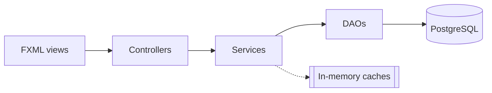

# Smart E-Commerce System

A JavaFX desktop application backed by PostgreSQL for managing an online store's categories,
products, inventory and orders, with reporting, in-memory caching, measured index optimization,
hand-written sorting and searching algorithms, and a MongoDB design for reviews and activity logs.

## Contents

- [Features](#features)
- [Tech stack](#tech-stack)
- [Architecture](#architecture)
- [Project structure](#project-structure)
- [Getting started](#getting-started)
- [Database design](#database-design)
- [Caching](#caching)
- [Performance optimization](#performance-optimization)
- [Data structures and algorithms](#data-structures-and-algorithms)
- [NoSQL design](#nosql-design)
- [Requirements coverage](#requirements-coverage)
- [Known limitations](#known-limitations)

## Features

| Tab | What it does |
|---|---|
| **Categories** | Add, edit and delete categories, with a case-insensitive duplicate check |
| **Products** | Full CRUD including stock; case-insensitive search; category filter; pagination |
| **Orders** | Place orders that check and reduce stock in one transaction; status workflow (PENDING → PAID → SHIPPED → DELIVERED, or CANCELLED); cancelling returns stock |
| **Reports** | Best-selling products, revenue by category, low-stock alert, top customers; date filters; CSV export; query timing |

All input is validated, and database errors (duplicates, products that are still referenced
by orders, insufficient stock) are shown as readable messages.

## Tech stack

| Part | Technology |
|---|---|
| Language | Java 17+ (Java Platform Module System) |
| UI | JavaFX with FXML |
| Relational database | PostgreSQL (with the `pg_trgm` extension) |
| Data access | JDBC, `PreparedStatement` only |
| Document database | MongoDB 7, run with Docker |
| Build | Gradle (Kotlin DSL) |

## Architecture



| Layer | Responsibility |
|---|---|
| **Controllers** | Handle UI events and display results. No SQL. |
| **Services** | Validation, business rules (e.g. allowed order-status changes), caching, and turning database errors into readable messages |
| **DAOs** | All SQL. Every value goes through a `?` placeholder. Multi-step writes (placing an order, saving a product with its stock, cancelling an order) run in a single transaction |

## Project structure

```
DB/                                repository root
├── README.md                      this file
├── Smart-E-Commerce-System-I.md   the project brief
├── docs/
│   └── erd/                       conceptual, logical and physical ERDs (Mermaid)
├── nosql/                         MongoDB design: Docker, setup script, queries, NOSQL.md
└── db_project/                    the Java application (Gradle project)
    ├── build.gradle.kts
    ├── gradlew, gradlew.bat
    ├── run_benchmark.sh / .bat    runs the indexing benchmark end to end
    ├── benchmark-results/         before.csv, after.csv, comparison.md
    ├── sql/
    │   ├── 01_schema.sql          tables, constraints, order_totals view
    │   ├── 02_seed.sql            small demo data set
    │   ├── 03_bulk_data.sql       ~100k products, ~50k orders for testing
    │   ├── 04_indexes.sql         performance indexes
    │   └── drop_indexes.sql
    └── src/main/
        ├── java/org/example/db_project/
        │   ├── HelloApplication.java  JavaFX entry point
        │   ├── controller/        one controller per tab + MainController
        │   ├── service/           validation, business rules, caching
        │   ├── dao/               SQL and transactions
        │   ├── model/             data classes, enums, records
        │   ├── exception/         InsufficientStockException
        │   ├── util/              DBConnection
        │   ├── dsa/               Algorithms + DsaDemo
        │   └── benchmark/         PerformanceBenchmark
        └── resources/org/example/db_project/
            └── *.fxml             one view per tab + main-view.fxml
```

Unless stated otherwise, the commands below are run from the **`db_project/`** folder.

## Getting started

### Prerequisites

- JDK 17 or newer
- PostgreSQL 13 or newer, with `psql` on your PATH
- Docker (only for the NoSQL part)

### 1. Create the database

```bash
cd db_project
createdb -U admin smart_ecommerce
psql -U admin -d smart_ecommerce -f sql/01_schema.sql
psql -U admin -d smart_ecommerce -f sql/02_seed.sql
```

Replace `admin` with your PostgreSQL user. `01_schema.sql` drops and recreates every table,
so running these two scripts again always resets the database to the demo data.

### 2. Configure the connection

Edit `db_project/src/main/java/org/example/db_project/util/DBConnection.java`:

```java
private static final String URL = "jdbc:postgresql://localhost:5432/smart_ecommerce";
private static final String USER = "admin";
private static final String PASSWORD = null;   // or your password
```

### 3. Run

From `db_project/`:

```bash
./gradlew run
```

Or run the `application > run` Gradle task from IntelliJ.

## Database design

Seven tables: `users`, `categories`, `products`, `inventory`, `orders`, `order_items`, `reviews`,
plus the `order_totals` view. All three ERD levels (conceptual, logical, physical) and a
table-by-table normalization explanation are in **[docs/erd/ERD.md](docs/erd/ERD.md)**.

Key decisions:

- **Normalized to 3NF.** Orders have no stored total, because it can be derived from
  `order_items`; the `order_totals` view calculates it.
- **`order_items.unit_price`** records the price at the time of purchase. It's a historical
  fact, not a duplicate of `products.price`, which can change later.
- **`inventory` is a separate 1:1 table**, because stock changes constantly while product details rarely do.
- **Composite primary key `(order_id, product_id)`** on `order_items` resolves the many-to-many
  between orders and products.
- **Delete rules:** a product that has been ordered can't be deleted (`RESTRICT`), keeping order history intact;
  deleting a product removes its stock record and reviews (`CASCADE`).
- **Constraints:** `CHECK` on prices, quantities, ratings, roles and statuses; case-insensitive
  uniqueness on category names and emails via unique indexes on `LOWER(...)`.
- **Race-safe stock updates:** placing an order runs
  `UPDATE inventory SET quantity_on_hand = quantity_on_hand - ? WHERE product_id = ? AND quantity_on_hand >= ?`,
  so the stock check and the decrement are one atomic step and two orders can never take the last unit.

## Caching

| Data | Structure | Invalidation |
|---|---|---|
| Categories | `LinkedHashMap<Integer, Category>`, shared by all tabs | Cleared after every insert, update or delete |
| Product search pages | `HashMap<String, ProductPage>` keyed by `keyword\|category\|page`; the keyword is lower-cased so "Phone" and "phone" share an entry, matching the case-insensitive search | Cleared after any product change, order or cancellation |
| Orders, reports | Not cached: they change with every purchase and must always be current | — |

Measured on 100,000 products, a cached product search took **0.01 ms**, against
**10.04 ms** for the same search going to the database.

## Performance optimization

### How it was measured

`PerformanceBenchmark` runs 14 queries mirrored from the DAOs on one connection, with warm-up runs,
and records the median time, PostgreSQL's own execution time (`EXPLAIN ANALYZE`) and the scans
used. To reproduce:

From `db_project/`:

```bash
PGUSER=admin ./run_benchmark.sh   # resets the DB, loads bulk data, measures, adds indexes, measures again
```

`PGUSER` is the PostgreSQL user the script connects as (it defaults to `postgres`).
Results are written to `db_project/benchmark-results/`; the raw comparison is in
[db_project/benchmark-results/comparison.md](db_project/benchmark-results/comparison.md). Afterwards, re-run `01_schema.sql` and `02_seed.sql` to get the demo data back.

### Results (PostgreSQL execution time, ~100k products / ~50k orders)

| Query | Before (ms) | After (ms) | Speed-up | Plan change |
|---|---:|---:|---:|---|
| Search 'phone' (common word), page 1 | 30.27 | 0.51 | 59× | Seq Scan → Index Scan on `idx_products_name_id` |
| Search '4242' (rare), page 1 | 13.63 | 0.07 | 200× | Seq Scan → Bitmap Index Scan on `idx_products_name_trgm` |
| Search count for 'phone' | 14.15 | 2.87 | 5× | Seq Scan → Bitmap Index Scan on `idx_products_name_trgm` |
| Browse all products, page 1 | 27.70 | 0.05 | 554× | Parallel Seq Scan → Index Scan on `idx_products_name_id` |
| Browse page 5000 (deep OFFSET) | 76.13 | 73.53 | 1.0× | No change |
| Browse one category, page 1 | 4.46 | 0.02 | 223× | Parallel Seq Scan → Index Scan on `idx_products_category_name` |
| Order history of one customer | 1.81 | 0.01 | 201× | Seq Scan → Bitmap Index Scan on `idx_orders_user_id` |
| Count orders in one month | 1.86 | 0.25 | 7× | Seq Scan → Bitmap Index Scan on `idx_orders_order_date` |
| Report: best sellers (all time) | 105.47 | 119.11 | 0.9× | No change |
| Report: best sellers (one month) | 14.48 | 13.25 | 1.1× | `orders` now uses `idx_orders_order_date` |
| Report: revenue by category (one month) | 14.09 | 12.72 | 1.1× | `orders` now uses `idx_orders_order_date` |
| Report: top customers (one month) | 12.18 | 9.77 | 1.2× | `orders` now uses `idx_orders_order_date` |
| Report: low stock | 15.45 | 12.64 | 1.2× | `inventory` now uses partial index `idx_inventory_low_stock` |
| Reviews written by one customer | 0.97 | 0.01 | 194× | Seq Scan → Bitmap Index Scan on `idx_reviews_user_id` |

Timings below about 0.1 ms are at the limit of reliable measurement; read those speed-ups as
"from tens of milliseconds to effectively instant" rather than exact ratios.

### Analysis

**Large gains came where a query needs a small, selective part of a table.**

- **Sorted pagination.** The `(name, product_id)` index is already in the order the query wants,
  so PostgreSQL reads the first 10 entries and stops instead of sorting 100,000 rows.
- **Substring search.** A normal B-tree can't help `ILIKE '%4242%'` because of the leading wildcard.
  The trigram GIN index splits names into 3-letter chunks and can.
- **Composite index.** `(category_id, name, product_id)` serves both the category filter and the sort,
  and its leftmost column also covers the foreign key.
- **Foreign keys.** PostgreSQL doesn't index them automatically; indexing `orders.user_id` and
  `reviews.user_id` turned full scans into direct lookups.

**Little or no gain where a query must read most of a table, which is the expected behaviour.**

- **Deep OFFSET** still has to step over 49,990 rows. Keyset pagination
  (`WHERE (name, product_id) > (?, ?) LIMIT 10`) would fix this.
- **All-time best sellers** aggregates the whole `order_items` table, so a full scan is the right plan;
  the small difference is run-to-run noise.
- **Monthly reports** now use the date index on `orders`, but scanning `order_items` dominates their cost.
- **Low stock** uses the partial index, but about 6% of products qualify and still need joining.

**Deliberately not indexed:** `orders.status` (only five distinct values, so an index rarely beats a scan)
and `products.price` (no query filters or sorts on it in SQL).

## Data structures and algorithms

Hand-written in `dsa/Algorithms.java`, applied to the product data by `dsa/DsaDemo.java`:

| Algorithm | Used for | Time complexity |
|---|---|---|
| Merge sort | Sorting all products by price | O(n log n), stable |
| Binary search | Finding a product by ID in a list sorted by ID | O(log n) |
| Linear search | Same lookup on an unsorted list (baseline) | O(n) |
| `HashMap` (hashing) | Same lookup through an ID → product map | O(1) average |

A comparison counter measures the work each algorithm does independently of machine speed.
Run from `db_project/` with the bulk data loaded:

```bash
./gradlew dsaDemo
```

### Results (~100k products)

```
Loaded 100,012 products

1. SORTING all products by price
   Merge sort (own)                  31.98 ms      1,536,718 comparisons
   Java List.sort (built-in)         22.55 ms
   Same result: true

2. FINDING one product by id (average of 1000 lookups)
   Linear search                O(n)           65.281 us       49,878.8 comparisons
   Binary search (sorted list)  O(log n)        0.540 us           15.7 comparisons
   HashMap lookup (hashing)     O(1)            0.303 us
```

What the results show:

- **Merge sort** made 1,536,718 comparisons for 100,012 products, in line with n·log₂n ≈ 1.66 million,
  as expected for an O(n log n) algorithm. It produced exactly the same order as Java's built-in sort.
  The built-in sort was faster (22.55 ms vs 31.98 ms) because TimSort is heavily optimized: it works
  on one array, while this merge sort creates new lists at every level of recursion.
- **Linear search** checked about 49,879 products per lookup, roughly half the list on average, which is O(n).
- **Binary search** needed only about 16 comparisons (log₂ 100,012 ≈ 16.6): around 3,200 times fewer
  than linear search, and about 120 times faster (0.540 µs vs 65.281 µs).
- **The HashMap** was fastest at 0.303 µs per lookup, because hashing jumps straight to the right bucket
  without comparing against other products.

### Mapping to database indexing

| In memory | In PostgreSQL |
|---|---|
| Linear search through a list | `Seq Scan`: reads every row |
| Binary search on a sorted list | B-tree index: data kept sorted, so a lookup takes about 16 steps instead of about 50,000 |
| `HashMap` lookup | Hash index / primary-key lookup: jump straight to the row |
| Sorting once so that every later search is fast | `CREATE INDEX`: pay once, speed up every later query |
| Merge sort | PostgreSQL's `ORDER BY` uses quicksort in memory and an external merge sort when data doesn't fit |
| `HashMap` caches in the services | Skipping the database entirely for repeated reads |

## NoSQL design

Product reviews and activity logs are modelled in MongoDB, where their flexible structure fits better.
Orders, inventory and payments stay in PostgreSQL because they need ACID transactions.

- **`product_reviews`**: reviewer details and merchant reply embedded; optional photos, pros and cons;
  `$jsonSchema` validation; a unique index for one review per user per product; a text index for search.
- **`activity_logs`**: event-specific `details` object; TTL index deletes logs after 90 days.
- **`product_rating_summary`**: a view with each product's average rating and star breakdown.

From the repository root (`DB/`):

```bash
cd nosql
docker compose up -d
docker exec -it smart-ecommerce-mongo mongosh smart_ecommerce /scripts/queries.js
```

Full design, justification and a relational-vs-document comparison:
**[nosql/NOSQL.md](nosql/NOSQL.md)**.

## Requirements coverage

| Requirement | Where |
|---|---|
| Conceptual, logical and physical models; 3NF | [docs/erd/ERD.md](docs/erd/ERD.md), `db_project/sql/01_schema.sql` |
| Keys, constraints, referential integrity | `db_project/sql/01_schema.sql` |
| Indexes on frequently searched or joined columns | `db_project/sql/04_indexes.sql` |
| CRUD through JavaFX with validation and feedback | Categories and Products tabs |
| Product listing, pagination, search filters, parameterized queries | Products tab, `ProductDAO` |
| Case-insensitive search, optimized with indexing | `ILIKE` + trigram index |
| In-memory caching with invalidation | `CategoryService`, `ProductService` |
| Sorting and searching algorithms, hashing | `db_project/src/main/java/org/example/db_project/dsa/` |
| Query times before and after indexing | [Performance optimization](#performance-optimization), `db_project/benchmark-results/` |
| NoSQL schema and justification | `nosql/`, [nosql/NOSQL.md](nosql/NOSQL.md) |
| Layered architecture (Controller → Service → DAO) | `controller/`, `service/`, `dao/` under `db_project/src/main/java/org/example/db_project/` |
| ERDs, SQL scripts, README | `docs/erd/`, `db_project/sql/`, this file |

## Known limitations

- **No login.** The app acts as an administrator; user password hashes in the seed data are placeholders.
- **Database calls run on the JavaFX thread.** Fine for this data size; a production version would use background tasks.
- **The Orders tab loads every order.** With the bulk data (~50,000 orders) it becomes slow and would need pagination.
- **Deep pagination uses OFFSET**, which slows down on later pages (see the analysis above).
- **MongoDB references aren't enforced.** `productId` and `userId` in MongoDB point to PostgreSQL rows,
  but no foreign key can span the two databases.