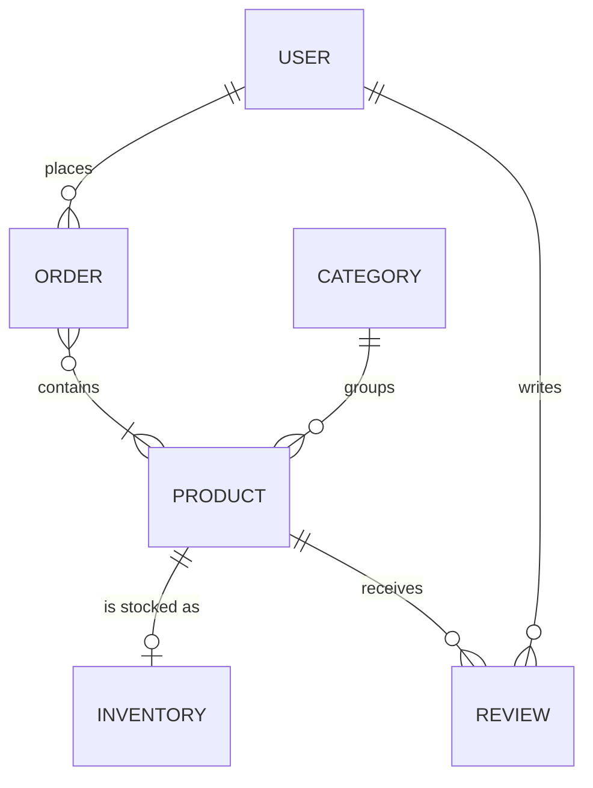
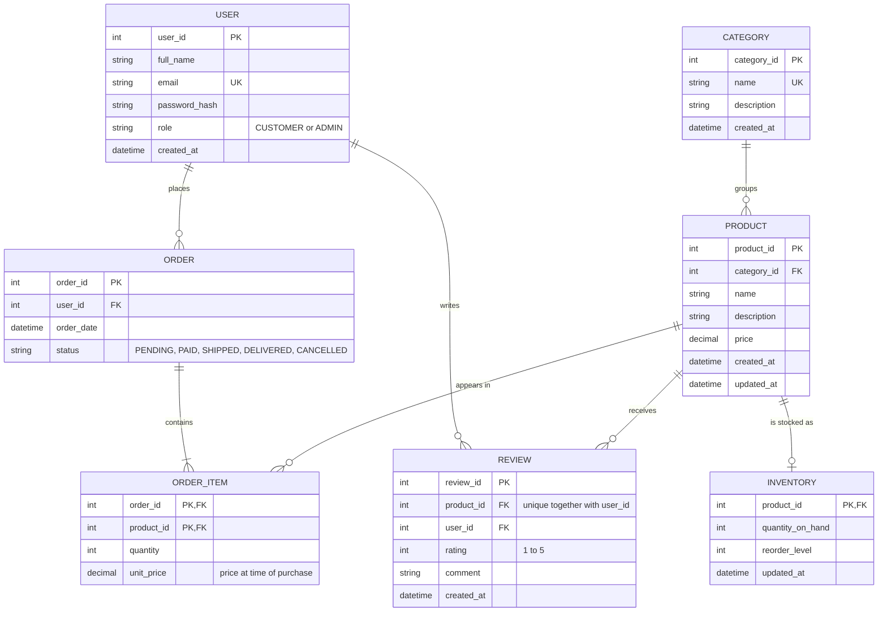

# Entity-Relationship Diagrams

## 1. Conceptual model

The main things the business deals with and how they relate. No attributes or keys yet.
The many-to-many between orders and products is shown directly; the logical model resolves it.

- A user places zero or more orders; every order belongs to one user.
- An order contains one or more products; a product can appear in many orders.
- Every product belongs to one category; a category can be empty.
- A product has at most one inventory record.
- A user can review many products, and a product can have many reviews.

## 2. Logical model

Attributes, primary keys (PK), foreign keys (FK) and unique keys (UK), with generic data types.
The order–product many-to-many is resolved by the associative entity `ORDER_ITEM`.

## 3. Physical model

The PostgreSQL implementation from `schema.sql`: exact data types, constraints, defaults and delete rules.
Relationship labels name the foreign-key column.

```mermaid
erDiagram
    users ||--o{ orders : "orders.user_id"
    orders ||--|{ order_items : "order_items.order_id"
    products ||--o{ order_items : "order_items.product_id"
    categories ||--o{ products : "products.category_id"
    products ||--o| inventory : "inventory.product_id"
    users ||--o{ reviews : "reviews.user_id"
    products ||--o{ reviews : "reviews.product_id"

    users {
        int user_id PK "GENERATED ALWAYS AS IDENTITY"
        varchar(100) full_name "NOT NULL"
        varchar(255) email UK "NOT NULL, unique index on LOWER(email)"
        varchar(255) password_hash "NOT NULL"
        varchar(20) role "NOT NULL, DEFAULT 'CUSTOMER', CHECK IN ('CUSTOMER', 'ADMIN')"
        timestamp created_at "NOT NULL, DEFAULT CURRENT_TIMESTAMP"
    }
    categories {
        int category_id PK "GENERATED ALWAYS AS IDENTITY"
        varchar(100) name UK "NOT NULL, unique index on LOWER(name)"
        text description
        timestamp created_at "NOT NULL, DEFAULT CURRENT_TIMESTAMP"
    }
    products {
        int product_id PK "GENERATED ALWAYS AS IDENTITY"
        int category_id FK "NOT NULL, ON DELETE RESTRICT"
        varchar(150) name "NOT NULL"
        text description
        numeric price "NUMERIC(10,2) NOT NULL, CHECK (price >= 0)"
        timestamp created_at "NOT NULL, DEFAULT CURRENT_TIMESTAMP"
        timestamp updated_at "NOT NULL, DEFAULT CURRENT_TIMESTAMP"
    }
    inventory {
        int product_id PK, FK "ON DELETE CASCADE"
        int quantity_on_hand "NOT NULL, DEFAULT 0, CHECK (>= 0)"
        int reorder_level "NOT NULL, DEFAULT 5, CHECK (>= 0)"
        timestamp updated_at "NOT NULL, DEFAULT CURRENT_TIMESTAMP"
    }
    orders {
        int order_id PK "GENERATED ALWAYS AS IDENTITY"
        int user_id FK "NOT NULL, ON DELETE RESTRICT"
        timestamp order_date "NOT NULL, DEFAULT CURRENT_TIMESTAMP"
        varchar(20) status "NOT NULL, DEFAULT 'PENDING', CHECK IN (5 statuses)"
    }
    order_items {
        int order_id PK, FK "ON DELETE CASCADE"
        int product_id PK, FK "ON DELETE RESTRICT"
        int quantity "NOT NULL, CHECK (quantity > 0)"
        numeric unit_price "NUMERIC(10,2) NOT NULL, CHECK (unit_price >= 0)"
    }
    reviews {
        int review_id PK "GENERATED ALWAYS AS IDENTITY"
        int product_id FK "NOT NULL, ON DELETE CASCADE, UNIQUE (product_id, user_id)"
        int user_id FK "NOT NULL, ON DELETE CASCADE"
        smallint rating "NOT NULL, CHECK (rating BETWEEN 1 AND 5)"
        text comment
        timestamp created_at "NOT NULL, DEFAULT CURRENT_TIMESTAMP"
    }
```

Also defined in `schema.sql`: the view **`order_totals`**, which calculates each order's
total as `SUM(quantity * unit_price)` from `order_items`.

## Normalization (3NF)

| Table | Why it's in 3NF |
|---|---|
| `users` | Every column depends only on `user_id`; email is unique but not used to derive other columns |
| `categories` | Single-key table, no repeating groups |
| `products` | Category details live in `categories` and are reached through `category_id`, not repeated per product |
| `inventory` | Depends wholly on `product_id`; split out because stock changes far more often than product details |
| `orders` | **No stored total**: it would be derived from `order_items` (a transitive dependency), so it's calculated by the `order_totals` view |
| `order_items` | Composite key `(order_id, product_id)`; `quantity` and `unit_price` depend on the whole key. `unit_price` is the price at purchase time, a fact of its own, not a copy of `products.price` |
| `reviews` | Every column depends only on `review_id`; `UNIQUE (product_id, user_id)` enforces one review per user per product |

## Indexes

Besides the primary keys and unique constraints shown above, `indexes.sql` adds:

| Index | Table | Purpose |
|---|---|---|
| `idx_products_name_trgm` (GIN, trigram) | products | `ILIKE '%keyword%'` search |
| `idx_products_name_id` | products | Browsing sorted by name |
| `idx_products_category_name` | products | Browsing one category; also covers the FK |
| `idx_orders_user_id` | orders | FK; a customer's order history |
| `idx_orders_order_date` | orders | Date ranges in reports |
| `idx_order_items_product_id` | order_items | FK to products |
| `idx_reviews_user_id` | reviews | FK to users |
| `idx_inventory_low_stock` (partial) | inventory | Low-stock report |
